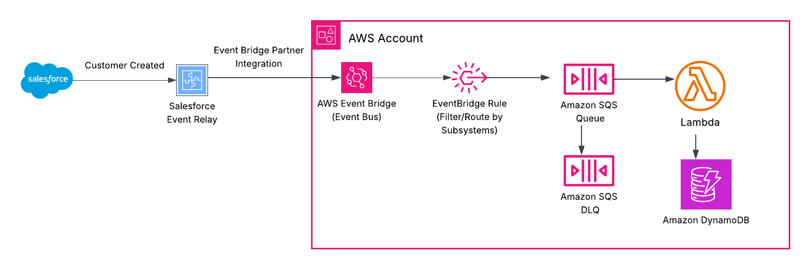

# Salesforce Event Relay to Amazon EventBridge

Sample code for the article *Streaming Salesforce Events to AWS with Event Relay and EventBridge*.

When a customer (Account) is created in Salesforce, a platform event called `Customer_Created__e` is published. Salesforce Event Relay delivers it to an EventBridge partner event bus. A rule sends it to an SQS queue, and a Python Lambda writes the customer to DynamoDB.



## Repository layout

```
salesforce/                          Salesforce project (deploy with the Salesforce CLI)
  force-app/main/default/
    objects/Customer_Created__e/     the platform event and its 3 fields
    triggers/CustomerCreatedPublisher.trigger   publishes the event when an Account is created
    classes/CustomerCreatedPublisherTest.cls    Apex test (needed for production deploys)
aws/                                 AWS CDK app (Python)
  stacks/customer_relay_stack.py     partner bus, rule, SQS queue + DLQ, Lambda, DynamoDB, DLQ alarm
  lambdas/customer_sync/             the Lambda function
  tests/                             unit tests for the Lambda and the stack
```

## Prerequisites

- A Salesforce org on Enterprise, Unlimited, or Developer edition, with the Customize Application permission. A free [Developer Edition org](https://developer.salesforce.com/signup) works.
- An AWS account in a [default AWS region](https://docs.aws.amazon.com/accounts/latest/reference/manage-acct-regions.html), such as `us-east-1`. Event Relay doesn't support opt-in regions.
- [Salesforce CLI](https://developer.salesforce.com/tools/salesforcecli) (`sf`). Install it with `npm install -g @salesforce/cli`, or use the installer from that page. Check it with `sf --version`.
- Python 3.12 or later
- Node.js and the [AWS CDK CLI](https://docs.aws.amazon.com/cdk/v2/guide/getting-started.html) (`npm install -g aws-cdk`)
- AWS CLI v2, signed in to the target account

The examples below use `us-east-1` and the placeholder account ID `123456789012`. Replace them with your own.

## Setup

The order matters. The relay has to exist before the CDK stack can create the partner event bus, because the bus is created from the partner event source that the relay registers in AWS.

### Step 1: Deploy the Salesforce metadata

This creates the `Customer_Created__e` event and the trigger that publishes it.

First, log in to your org. This opens a browser where you sign in to Salesforce and approve access. The CLI then remembers the org under the alias `relay-dev`, which the other commands use through `--target-org`. You only need to log in once.

```bash
sf org login web --alias relay-dev
```

Then deploy:

```bash
cd salesforce
sf project deploy start --target-org relay-dev
```

If you'd rather not use the CLI, you can create the same things in the browser: the event and its 3 fields under **Setup > Platform Events**, and the trigger and test class in the **Developer Console**. The code is in `salesforce/force-app/main/default`.

For a production org, Salesforce requires the Apex test to run during the deploy:

```bash
sf project deploy start --target-org relay-prod \
  --test-level RunSpecifiedTests --tests CustomerCreatedPublisherTest
```

### Step 2: Create the named credential

The named credential tells Salesforce which AWS account and region to deliver to. It holds no AWS keys.

1. In Salesforce Setup, go to **Named Credentials**.
2. Choose **New Legacy**. Event Relay requires a legacy named credential.
3. Fill in:

| Field | Value |
|---|---|
| Label / Name | `AWS_EventBridge` |
| URL | `arn:aws:US-EAST-1:123456789012` (your account ID; the region must be uppercase) |
| Identity Type | Named Principal |
| Authentication Protocol | No Authentication |

4. Save.

You can't change the account or region once a relay uses the credential. To change them later, delete the relay, edit the credential, and create the relay again.

### Step 3: Create the channel

There's no Setup screen for channels, so this uses the Tooling API. The easiest way is [Workbench](https://workbench.developerforce.com):

1. Log in to Workbench with your org.
2. Go to **Utilities > REST Explorer**.
3. Send this request:

- Method: `POST`
- URI: `/services/data/v68.0/tooling/sobjects/PlatformEventChannel`
- Body:

```json
{
  "FullName": "Customer_Relay__chn",
  "Metadata": {
    "channelType": "event",
    "label": "Customer Relay"
  }
}
```

### Step 4: Add the event to the channel

In the same REST Explorer, send:

- Method: `POST`
- URI: `/services/data/v68.0/tooling/sobjects/PlatformEventChannelMember`
- Body:

```json
{
  "FullName": "Customer_Relay_chn_Customer_Created_e",
  "Metadata": {
    "eventChannel": "Customer_Relay__chn",
    "selectedEntity": "Customer_Created__e"
  }
}
```

### Step 5: Create the event relay

1. In Setup, go to **Event Relays** and choose **New**.
2. Fill in:
   - Name: `Customer_Relay`
   - Named credential: `AWS_EventBridge`
   - Event channel: `Customer_Relay__chn`
   - Error recovery: **Earliest**. This resends events published during an outage, up to 72 hours. The Lambda handles the duplicates this can cause.
3. Save, then set the relay state to **Run**. Its status changes to **Starting** and stays there until the next step is done.

Salesforce now registers a partner event source in your AWS account. In the AWS console, go to **Amazon EventBridge > Integration > Partner event sources**. You'll see a pending source with a name like:

```
aws.partner/salesforce.com/00D5g000000XXXXEAA/0YL5g000000XXXXGAA
```

Copy the full name. Don't choose **Associate with event bus** in the console. The CDK stack does that in the next step.

### Step 6: Deploy the AWS stack

```bash
cd aws
python -m venv .venv
source .venv/bin/activate
pip install -r requirements.txt

cdk bootstrap                      # once per account and region
cdk deploy \
  -c partnerEventSourceName=aws.partner/salesforce.com/00D5g000000XXXXEAA/0YL5g000000XXXXGAA \
  -c alertEmail=you@example.com    # optional: email for the DLQ alarm
```

`partnerEventSourceName` is required. `alertEmail` is optional. If you set it, confirm the subscription email that SNS sends you.

Creating the partner event bus associates it with the partner event source. The source becomes **Active** in EventBridge, and the relay status in Salesforce moves from **Starting** to **Running**. This can take a few minutes.

## Test it

Create an Account in Salesforce, either in the UI or from the CLI:

```bash
sf data create record --target-org relay-dev --sobject Account \
  --values "Name='Example Corp' Industry=Manufacturing"
```

The command prints the new Account ID. Check that the customer arrived in DynamoDB:

```bash
aws dynamodb get-item --table-name customers \
  --key '{"account_id": {"S": "<account-id>"}}'
```

Watch the Lambda logs:

```bash
aws logs tail /aws/lambda/customer-sync --follow
```

## Checking the relay status

Salesforce doesn't alert you when a relay fails. Check its status with the `EventRelayFeedback` object:

```bash
sf data query --target-org relay-dev \
  -q "SELECT Status, ErrorMessage, ErrorTime, RemoteResource FROM EventRelayFeedback"
```

A healthy relay shows `RUNNING`.

## If nothing arrives

Check each step in order:

| Where | What to check |
|---|---|
| Salesforce | The trigger is active, and the Account was saved successfully. |
| Event Relay | `EventRelayFeedback.Status` is `RUNNING`, and `ErrorMessage` is empty. |
| Partner event source | It's **Active** in the EventBridge console, not **Pending**. |
| Rule | In CloudWatch, the `AWS/Events` metric `MatchedEvents` for the rule `customer-created-to-queue` is above 0. |
| Queue and Lambda | The Lambda logs show `Customer stored` or `Duplicate skipped`. Errors appear in the logs and, after 5 attempts, the message moves to the DLQ. |
| DLQ | If messages are there, read one to see the event and check the Lambda logs for the error. After fixing the cause, [redrive](https://docs.aws.amazon.com/AWSSimpleQueueService/latest/SQSDeveloperGuide/sqs-configure-dead-letter-queue-redrive.html) them to the main queue. |

## Run the tests

```bash
cd aws
pip install -r requirements-dev.txt
pytest
```

The tests cover the Lambda (new customer, duplicate, partial batch failures) and the stack resources. They don't need an AWS account.

## Tear down

1. In Salesforce Setup, go to **Event Relays**, stop the relay, then delete it.
2. Remove the AWS stack. This deletes the partner event bus, queues, Lambda, and DynamoDB table, including its data:

   ```bash
   cd aws
   cdk destroy
   ```

3. In Workbench REST Explorer, delete the channel member, then the channel, with `DELETE` requests to `/services/data/v68.0/tooling/sobjects/PlatformEventChannelMember/<id>` and `/services/data/v68.0/tooling/sobjects/PlatformEventChannel/<id>`. You can find the IDs with a Tooling API query such as `SELECT Id, DeveloperName FROM PlatformEventChannel`.
4. Delete the named credential in Setup.
5. Optionally, remove the Salesforce metadata (the trigger, test class, and event).

## Notes

- **Cost.** Event Relay itself has no separate charge. Relayed events count toward the org's daily event delivery allocation. On AWS, partner events are billed per million events, plus the usual SQS, Lambda, and DynamoDB charges. See [EventBridge pricing](https://aws.amazon.com/eventbridge/pricing/).
- **Sandboxes.** Event relays aren't copied when a sandbox is created or refreshed. Repeat steps 2 to 6 in each sandbox.
- **Production data.** The DynamoDB table uses `RemovalPolicy.DESTROY` so `cdk destroy` cleans up the demo. Change it to `RETAIN` for real data.

## License

MIT. See [LICENSE](LICENSE).
